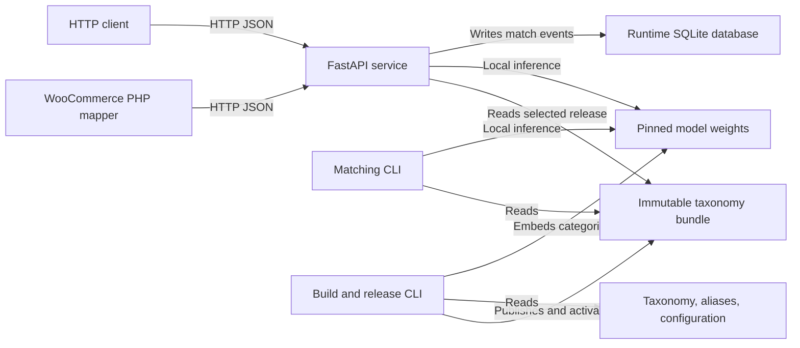
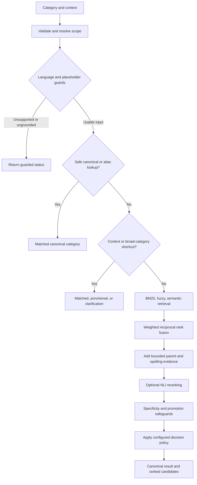
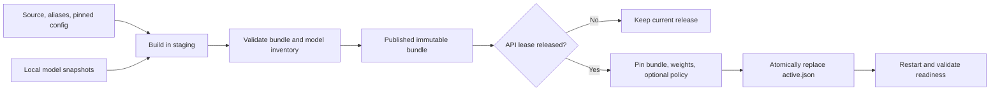

# Architecture and matching flow

The application is a modular Python service with a CLI over the same matching
engine. Inference returns canonical records from a versioned taxonomy bundle.
The WooCommerce plugins are separate projects; PHP calls this service over HTTP.

## Runtime topology

All service components run in one process. `api/app.py` owns routing and request
boundaries; `api/service.py` schedules matching on one dedicated executor thread.
That thread owns the matcher and taxonomy SQLite connection. The event loop uses
an immutable category snapshot for canonical lookups. Runtime writes use separate,
short-lived connections. Ordinary CLI matching does not record HTTP match events.

Startup validates the active managed release, initializes runtime migrations, loads
the matcher, and warms the inference path. A matcher adapter loads models lazily;
the API startup warmup makes the neural models resident before readiness succeeds.
The service holds a shared file lease while running, blocking activation/rollback.

## Matching stages

The diagram shows the default hybrid path; CLI `exact`, `fuzzy`, `bm25`, and
`semantic` modes can select narrower retrieval behavior. `method: exact` exits
without hybrid retrieval when no safe lookup is available. With no qualified
policy, non-exact retrieval remains provisional. Conservative literal canonical
wrappers can also return `matched` through the context/broad-category shortcuts.

1. **Validate:** normalize exact keys separately from retrieval text, enforce input
   limits and enabled language hints, and resolve explicit IDs and parent constraints.
2. **Guard placeholders:** a name such as `Uncategorized` has no product meaning
   without explicit useful context and returns clarification before neural retrieval.
3. **Look up known names:** accept an unambiguous canonical label/path or approved
   alias only when scope and supplied context support the lookup.
4. **Use context conservatively:** generic merchandising/audience/attribute labels
   may inherit a grounded source ancestor provisionally. Conflicting or ambiguous
   ancestors require clarification. Canonical inline context can restrict scope.
5. **Retrieve:** combine lexical, spelling, and semantic evidence within the allowed
   Google subtree, excluding unsupported audience-specific categories where applicable.
6. **Rank:** score a bounded candidate set with the pinned NLI model and combine its
   ranking with retrieval ranks; preserve remaining candidates and evidence.
7. **Apply safeguards:** preserve supported retrieval winners when model promotion
   is weak, avoid treating parent-only model support as evidence for a specific child,
   and keep spelling/literal-group interpretations visible.
8. **Decide:** a qualified policy may accept or abstain; a draft policy only produces
   CLI previews. The API serializes accepted assignments separately from suggestions.

### Default ranking configuration

These are current source defaults, pinned into each built manifest:

| Setting | Value |
|---|---|
| Embedding model | `Xenova/multilingual-e5-small`, INT8 ONNX, 384 dimensions |
| Ranking model | `onnx-community/multilingual-MiniLMv2-L6-mnli-xnli-ONNX`, INT8 |
| Retrieval budgets | BM25 100, semantic 100, fuzzy 50 |
| Retrieval fusion | Constant 10; weights BM25 1, fuzzy 1, semantic 5 |
| Fused pool | Up to 200, then up to 5 additional parents |
| NLI candidate budget | First 20 candidates; one pair per inference batch |
| NLI fusion | Weight 3, rank constant 10 |
| Pair templates | `The product category is {query}.` / `The product category is {label}.` |

`config/onnx_model_pins.json` pins exact downloads. Preparation writes separate ONNX
metadata, including file hashes, two CPU threads, and enabled input languages.
`config/category_ranking.json` overrides ranking templates and limits when building.
E5 applies `query: ` / `passage: ` prefixes, masked mean pooling, and L2 normalization.
The NLI adapter reads entailment at index 0, unlike the retained legacy DeBERTa
adapter's index 1. The active manifest is the runtime authority.

`onnx_backend.py` loads only verified local graph bytes on CPU, with direct Rust
tokenizers and NumPy postprocessing. Default inference does not load PyTorch or
SentenceTransformers. ONNX release inventories include only the five pinned files;
mutable Hugging Face download metadata is excluded. Legacy tools require the
optional `legacy` dependency extra and separately built compatible bundles.

## Scoring mechanics

- Semantic search calculates cosine distance for the label and path vectors and
  retains each category's best similarity, `1 - minimum_distance`, within scope.
- Retrieval fusion sums `branch_weight / (10 + branch_rank)` for each category;
  deduplication prevents repeated votes from the same branch.
- NLI evidence uses the entailment logit minus `logsumexp` of contradiction and
  neutral logits. The final configured rank score is `1 / (10 + retrieval_rank)`
  plus `3 / (10 + model_rank)` for candidates scored by the model. Unscored
  candidates retain the retrieval contribution.

These scores organize evidence. The acceptance policy and source-context guards
control whether a selection is reliable enough to assign. See `storage.py`,
`retrieval.py`, and `reranker.py` for the exact formulas and tie-breaking rules.

## Source hierarchy and result semantics

`source_ancestors` lists WooCommerce names from root to immediate parent. These
names are soft evidence and may place Google siblings under one another. They
must not become Google IDs or indiscriminate hard subtree restrictions.
`parent_category_id` is an explicit Google constraint. The legacy `label|context`
syntax is parsed separately; a uniquely canonical context can narrow the scope.

For example, `Collections` under `Clothing > Men > Tops > Hoodies & Sweatshirts|Clothing`
can inherit `212 - Apparel & Accessories > Clothing > Shirts & Tops` provisionally.
A standalone `Collections` requires context, and `Uncategorized` cannot acquire a
product meaning just by having an ancestor.

Only `matched` assigns `category`. For a provisional result, the API may expose the
first final-ranked candidate as `provisional_category` with `requires_review: true`.
That is a reviewable selection. Scores are ordering evidence, not correctness
probabilities. See the [API contract](API.md#responses).

## Build and activation

The supported CLI uses `bundles.stage_build` and `bundles.activate` rather than
calling the lower-level builder's pointer-writing helper directly. Staging leaves
the active release untouched. A release records the manifest hash, model file
hashes, and optional policy snapshot. Rollback selects a retained compatible release;
it does not revert application code or model dependencies.

## Storage boundaries

| Location | Contents and lifecycle |
|---|---|
| `google_category_list.txt`, `data/google/aliases.jsonl`, `config/` | Version-controlled build inputs |
| `models/` | Local metadata and weights; snapshots currently contain installation-specific absolute paths |
| `artifacts/google/<artifact_version>/` | Read-only taxonomy SQLite, compiled aliases, BM25 files, audit, and manifest |
| `artifacts/google/.releases/` | Immutable release descriptors and optional policy snapshots |
| `artifacts/google/active.json` | Selected artifact/release and previous release pointer |
| `var/category_matcher.sqlite3` | Mutable match-event requests/responses and migration history |
| `data/google/evaluation/`, `data/google/reviews/` | Development labels, source-bound review packets, and provenance |

Taxonomy schema version 1 stores `categories`, `category_closure`, and
`category_embeddings`; `sqlite-vec` provides vector functions for scoped similarity
queries. Each category has label and path embedding representations. The runtime
schema is independently versioned at 2 and uses WAL. Historical migration 2 and
its unused retired-feedback table remain solely for database compatibility.

Built runtime matching reads compiled aliases from the artifact, not the source
`data/google/` files. Data source edits take effect only after building and activating
an appropriate bundle. [Operations](OPERATIONS.md) covers the lifecycle commands.
